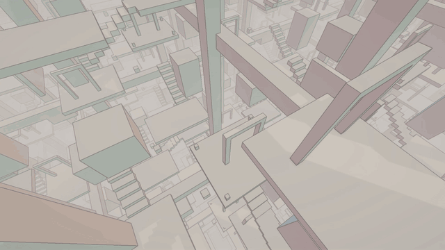
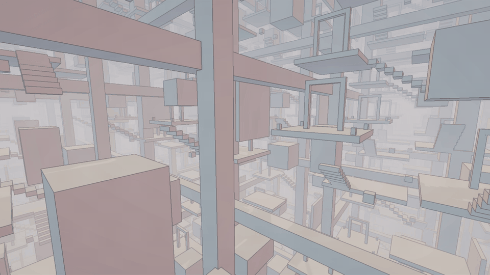

# Infinite Garden

Manifold Garden–inspired infinite architecture in **Unity 6 URP**: anti-aliased SDF outlines, an endlessly repeating world drawn with GPU instancing, a fog-to-sky atmosphere, and a frame budget measured on a laptop GTX 1650 Ti and on Intel UHD integrated graphics.



- **3.6 ms GPU** for the full look at 1080p on a GTX 1650 Ti (laptop).
- **78 fps on Intel UHD integrated graphics** at 1080p output (low-end preset, 75% render scale), with the 99th-percentile frame at 15.9 ms, inside a 60 fps budget.

## How it works

**Outlines (`IG_Edges.shader`, `IGEdgeFeature.cs`).** A Render Graph post pass compares depth and normals of up to 20 neighbouring pixels. An edge lies halfway between two pixels that belong to different surfaces, so the distance to the nearest discontinuity forms a distance field; the line is drawn as an anti-aliased iso-line of it, so no MSAA or TAA is needed. Depth tolerance is relaxed at grazing angles (otherwise distant floors turn into stripes), and lines fade and fog with distance. The pass reads the camera colour and writes into a new texture that becomes the camera colour, so there is no extra copy.



**Infinite world (`IGWorldRepeater.cs`, `IGFlyCamera.cs`).** One 48 m tile of level geometry is merged into a single mesh and drawn in a 3D grid of cells around each camera with `Graphics.RenderMeshInstanced`. The fog end distance defines the view radius, so the atmosphere decides how many copies are paid for. Cells are frustum-culled, only the cells next to the camera cast shadows (and are never frustum-culled, since they can cast shadows into view), and the camera wraps around the tile, which is what makes falling forever possible without floating-point drift.

**Atmosphere (`IGCommon.hlsl`, `IGAtmosphere.cs`, `IG_Sky.shader`).** One shared function drives fog on geometry, the outline fade and the sky, so the world dissolves into exactly the sky colour. A squared exponential keeps the foreground crisp, and a hard end guarantees full fog at the view distance.

**Surfaces (`IG_Surface.shader`).** The colour of a face comes from the direction it faces (the gravity it is a floor for), blended by squared normal components; wrapped sun lighting, soft shadows, SSAO. No textures. SRP Batcher compatible and instancing ready.

**Frame budget (`IGBudgetHUD.cs`, `IGBenchmark.cs`).** An on-screen HUD shows GPU/CPU time from `FrameTimingManager` and toggles every feature with hotkeys. A player started with `-benchmark` runs a repeatable benchmark and writes a CSV.

## Frame budget

Release build, 1920×1080 output, Direct3D 11, Intel i5-10300H laptop on AC power. Each of 14 configurations replays the same camera path: 2 s warm-up, 6 s measurement, 3 passes (even passes in reverse order), median of the passes. GPU time from `FrameTimingManager`. Raw data: [`benchmarks/`](benchmarks/).

| Configuration | GTX 1650 Ti, GPU ms | Intel UHD, GPU ms | Intel UHD, fps | Intel UHD, p99 frame |
|---|---|---|---|---|
| **Full look** (all on, 300 m view) | **3.56** | **39.0** | 25 | 43.2 ms |
| Outlines off | 1.94 | 26.1 | 38 | 31.3 ms |
| Outlines 4 / 8 taps (of 20) | 2.39 / 2.68 | 30.4 / 32.7 | 33 / 30 | 35.5 / 37.1 ms |
| SSAO off | 2.48 | 27.2 | 36 | 31.5 ms |
| Shadow-casting rings 0 / 2 (of 1) | 3.49 / 3.72 | 38.5 / 40.1 | 26 / 25 | 42.6 / 45.8 ms |
| Far LOD off | 3.38 | 37.6 | 26 | 41.8 ms |
| Frustum culling off (1425 cells instead of 324) | 4.14 | 42.3 | 23 | 48.6 ms |
| View distance 180 / 420 m | 3.37 / 3.75 | 37.5 / 40.3 | 26 / 25 | 42.3 / 43.3 ms |
| Low-end preset (8 taps, no SSAO, no shadow rings, 240 m) | 1.56 | 19.9 | 50 | 23.5 ms |
| Full look at 75% render scale | 2.13 | 23.9 | 41 | 27.9 ms |
| **Low-end preset at 75% render scale** | **1.05** | **12.6** | **78** | **15.9 ms** |

On the GTX the frame is no longer GPU-bound (about 200 fps in every configuration), so the GPU column is the one to read.

### What the numbers say

- **Two full-screen passes are most of the frame.** Outlines and SSAO cost 1.6 + 1.1 ms on the GTX and 12.9 + 11.8 ms on the iGPU. Geometry is cheap: culling removes 1100 cells and still saves only 0.6 ms on the GTX.
- **Integrated graphics are pixel-bound,** so the biggest lever there is the number of pixels: 75% render scale takes the low-end preset from 19.9 to 12.6 ms.
- **Depth priming is free here.** Outlines and SSAO already need a depth-normals prepass, so the forward pass can reuse that depth and shade each pixel once: 44.4 → 39.0 ms for the full look on Intel UHD (−12%).
- **The far LOD does not pay off.** It only strips 13% of a tile's triangles (648 → 564). Before depth priming the LOD version was even 5.6 ms slower on the iGPU; with depth priming the gap shrinks to 1.4 ms, so most of it was overdraw caused by draw order. It is kept as a toggle; a real project would drop it or use impostors.

## Run it

Unity **6000.6.4f1** (URP 17.6). Open `Assets/InfiniteGarden/Scenes/Garden.unity` and press Play.

| Key | Action |
|---|---|
| T | Tour (fixed path) |
| F | Fall forever |
| G | Fly: WASD, Q/E down/up, Shift faster, hold right mouse button to look |
| 1 / 2 | Outlines on/off / taps 4-8-20 |
| 3 | SSAO on/off |
| 4 / 5 / 6 | Shadow rings / far LOD / frustum culling |
| 7 / 8 | View distance −/+ 60 m |
| 0 | Edge mask |
| H | Hide HUD |

**Benchmark:** build for Windows, put [`benchmarks/RunBenchmark.bat`](benchmarks/RunBenchmark.bat) next to the `.exe` and run it (about 6 minutes). Choose the GPU in *Windows Settings → System → Display → Graphics*. The CSV is written next to the executable.

## Project layout

```
Assets/InfiniteGarden/
  Shaders/    IGCommon.hlsl, IG_Surface.shader, IG_Edges.shader, IG_Sky.shader
  Scripts/    IGEdgeFeature, IGWorldRepeater, IGFlyCamera, IGAtmosphere, IGBudgetHUD, IGBenchmark
  Materials/  IG_Surface, IG_Edges, IG_Sky
  Scenes/     Garden.unity
  Settings/   IG_VolumeProfile
Assets/Settings/  URP assets (PC renderer: IG Edges + SSAO, depth priming forced)
benchmarks/       raw CSV results and the benchmark runner
```

## Credits

Visual style inspired by *Manifold Garden* by William Chyr Studio. The outline and world-wrapping ideas follow Arthur Brussee's SIGGRAPH 2020 talk *"That's a wrap: Manifold Garden rendering retrospective"*. No assets from the game are used; all geometry is built from cubes.

## License

[MIT](LICENSE)
